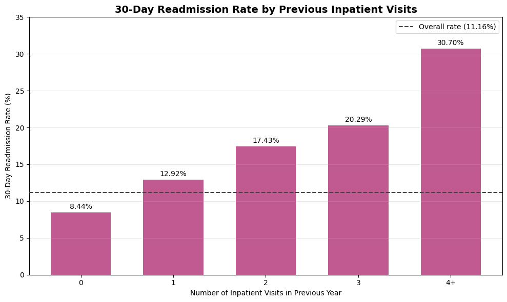
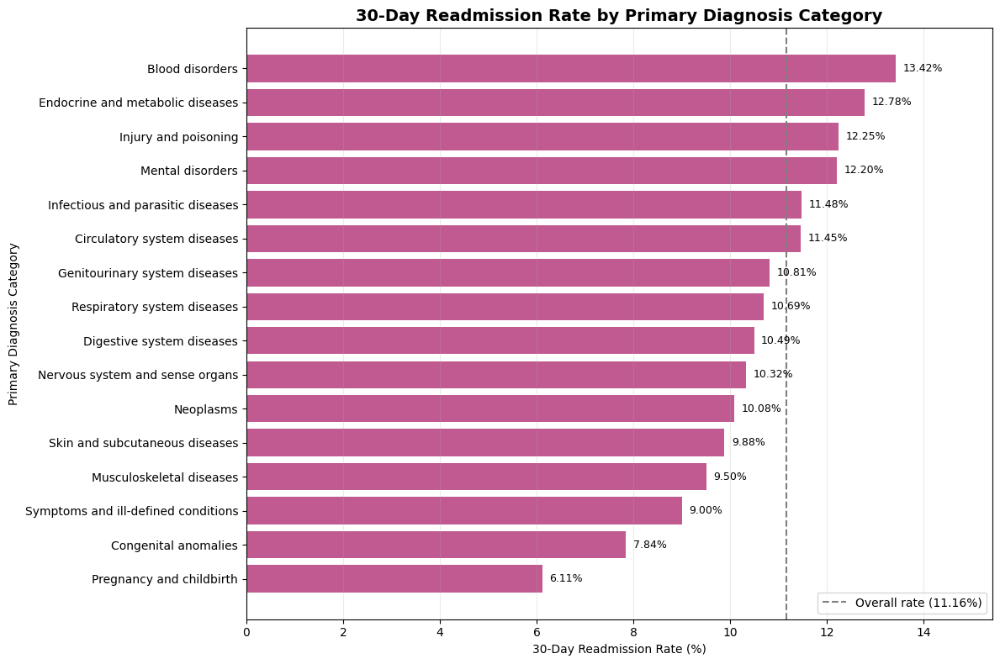
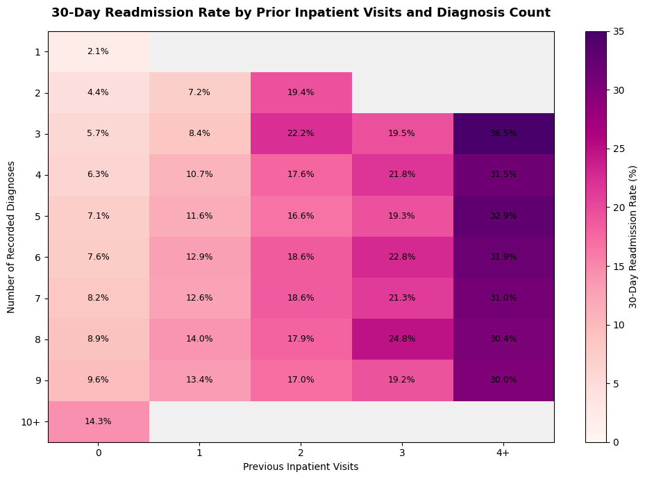

# Hospital Readmission Analysis: Patients with Diabetes

## Project Overview

My background in physiotherapy has given me firsthand experience with patient care and an understanding of how different factors can influence health outcomes. As I've transitioned into healthcare data analytics, I've become increasingly interested in how data can help us better understand patterns in healthcare and support more informed decisions.

For this project, I explored hospital readmissions among patients with diabetes to better understand which patient characteristics and hospital encounter factors are associated with readmission within 30 days.

Using Python, I worked with a dataset containing **101,766 hospital encounters** across 130 U.S. hospitals between 1999 and 2008. My goal was to move beyond simply calculating readmission rates and explore the patterns behind them.

## Research Question

**What patient characteristics and hospital encounter factors are associated with readmission within 30 days among patients with diabetes?**

I focused on two main objectives:

1. Determine the percentage of hospital encounters followed by readmission within 30 days.
2. Explore which patient characteristics and hospital encounter factors are associated with higher or lower readmission rates.

## Dataset and Tools

**Dataset:** Diabetes 130-US Hospitals (1999–2008), UCI Machine Learning Repository

**Tools and technologies:**
- Python
- Pandas and NumPy
- Matplotlib
- Jupyter Notebook

The dataset includes information about patient demographics, primary diagnoses, hospital stays, medications, procedures, previous healthcare utilization, and readmission outcomes.

## My Approach

I started by exploring the dataset to understand its structure and identify potential data quality issues, including missing values, invalid entries, and unusual observations.

After cleaning and validating the data, I used official ICD-9-CM coding references to group primary diagnoses into broader clinical categories. This allowed me to compare readmission patterns across different types of medical conditions while preserving the original diagnosis information.

I then calculated 30-day readmission rates across patient characteristics, hospital encounter factors, and previous healthcare utilization.

Finally, I explored how previous inpatient visits and the number of recorded diagnoses relate to each other and to readmission, using visualizations to communicate the findings.

Throughout the analysis, I focused on validating results, understanding the limitations of the data, and distinguishing observed associations from causal relationships.

## Key Findings

### Overall Readmission Rate

Of the 101,766 hospital encounters analyzed, **11,357 (11.16%)** were followed by readmission within 30 days.

### Previous Healthcare Utilization

One of the clearest patterns I observed was the relationship between previous hospital utilization and readmission.

Encounters with no previous inpatient visits had a readmission rate of **8.44%**, compared with **30.70%** among those with four or more previous inpatient visits.

A similar pattern appeared with previous emergency visits, where readmission rates increased from 10.47% for no previous visits to 24.94% for three or more visits.

Previous outpatient utilization showed a different pattern, with rates increasing initially before leveling off.

### Number of Recorded Diagnoses

Readmission rates generally increased with the number of documented diagnoses.

Encounters with one recorded diagnosis had a readmission rate of **5.94%**, compared with **12.38%** among those with nine diagnoses.

When I explored this relationship alongside previous inpatient visits, I found that readmission rates generally continued to increase with prior inpatient utilization, even within the same diagnosis-count groups.

### Patient Characteristics and Clinical Factors

Readmission rates also varied across age groups, primary diagnosis categories, and hospital encounter characteristics.

Among standard ICD-9-CM disease chapters, blood disorders had the highest observed readmission rate (13.42%), while circulatory system diseases accounted for the largest number of readmissions.

The relationship between age and readmission was non-linear, while the difference between female and male readmission rates was relatively small.

Length of hospital stay, number of medications, and laboratory procedure counts also showed varying associations with readmission.

## Key Visualizations

### Previous Inpatient Visits and 30-Day Readmission

### Primary Diagnosis Categories

### Previous Inpatient Visits and Recorded Diagnoses

## Limitations

Although the analysis revealed several interesting patterns, there are important limitations to consider.

The dataset contains historical hospital records from 1999–2008, so the findings may not reflect current healthcare practices. The analysis was conducted at the hospital encounter level, meaning that some patients may appear more than once.

Additionally, some variables had substantial missing information, and certain subgroups contained relatively few encounters. The number of recorded diagnoses also may not fully represent a patient's clinical complexity.

Most importantly, this was an exploratory analysis. The relationships identified do not establish causation or confirm that individual characteristics independently predict readmission.

## Conclusion

This project helped me explore how patient characteristics, documented diagnoses, and healthcare utilization patterns relate to hospital readmissions.

Previous inpatient and emergency visits, along with the number of recorded diagnoses, showed some of the clearest associations with 30-day readmission.

Beyond the findings themselves, this project gave me an opportunity to combine my clinical background with data analytics—working through real healthcare data, validating my approach, questioning unexpected results, and communicating findings in a way that is meaningful within a healthcare context.

It's the kind of work I hope to continue doing: using data to better understand healthcare challenges and contribute to more informed decisions that ultimately support patient care.

## Data Source

**UCI Machine Learning Repository:** [Diabetes 130-US Hospitals for Years 1999–2008](https://archive.ics.uci.edu/dataset/296/diabetes+130-us+hospitals+for+years+1999-2008)

**Clinical coding reference:** CMS ICD-9-CM Diagnosis Code Descriptions, Version 25.

## Reproducing the Analysis

The analysis is available in `readmission_analysis_final.ipynb`.

To reproduce the results:

1. Install the dependencies listed in `requirements.txt`.
2. Place the original dataset files in the `data/` directory and the ICD-9-CM reference file in `references/`.
3. Run the notebook from beginning to end using Jupyter Notebook or VS Code.

This project is intended for exploratory healthcare data analysis and should not be used for clinical decision-making.

